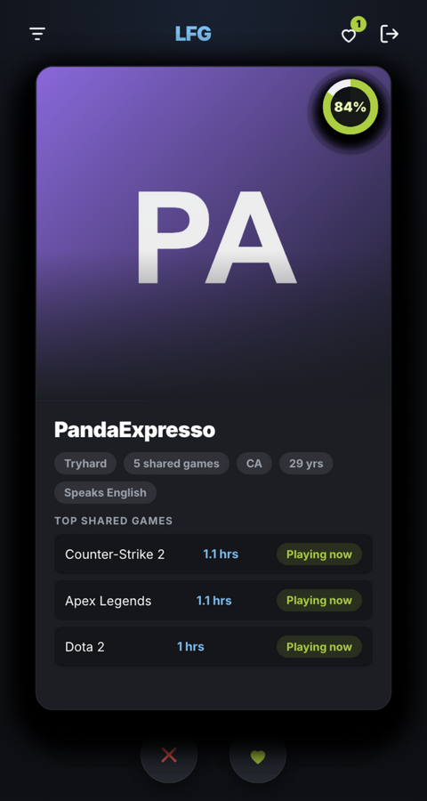
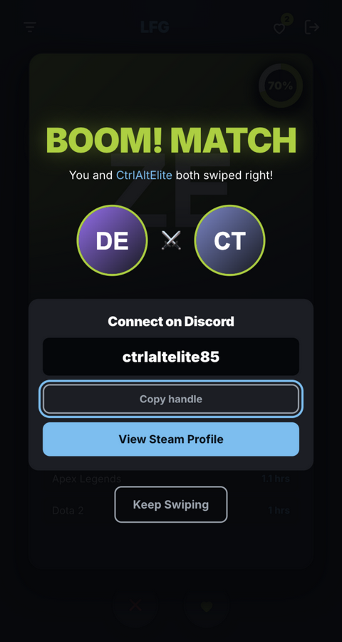
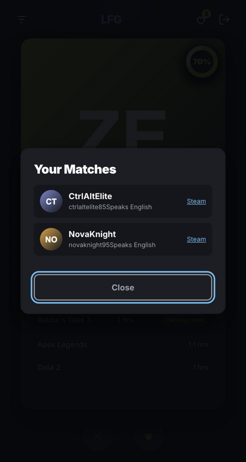
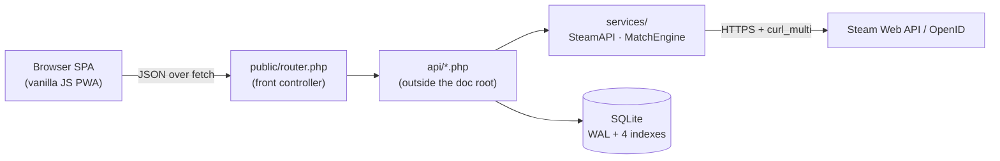

# Steam Matchmaking Platform 🎮

[](https://github.com/Sujaya-Nimneth/steam-matchmaking-platform/actions/workflows/ci.yml)
[](https://www.php.net/)
[](#tech-stack)
[](LICENSE)

Think Tinder, but for finding your gaming duo. Log in with Steam, and the
platform ranks other players by a compatibility score computed from your real
game libraries and playtime — then you swipe, match, and take the conversation
to Discord. No passwords, no fake profiles: everything comes from the official
Steam Web API.

<p align="center">
  
  
  
</p>

## Try it in two commands

No Steam key needed — the repo ships a deterministic demo dataset:

```bash
DEMO_MODE=1 docker compose up -d --build
# open http://localhost:8080/api/auth.php?demo_login=76561198000000001
```

The demo database contains 31 players with overlapping libraries, a few
pre-seeded likes (your first right swipe is an instant match) and one
confirmed match. `DEMO_MODE` only enables a dev-only login route — never set
it in production.

## Features

- **Secure Steam authentication** — Steam OpenID 2.0 with full assertion
  validation (including the "unsigned `claimed_id`" attack), session ID
  rotation on login and a 30-day absolute session expiry.
- **Automatic library sync** — profile, VAC-ban status, owned games and
  recent playtime are fetched concurrently from the Steam Web API and stored
  in one batched transaction.
- **A matchmaking engine that goes deeper than shared games** — see
  [How matching works](#how-matching-works).
- **Swiping with a real card deck** — pointer-drag with momentum, LIKE/PASS
  stamps, keyboard arrows, incremental prefetch, and a match celebration
  that reveals the other player's Discord handle only on a mutual like.
- **Server-side filters** — playstyle, country, spoken language and a
  "no VAC bans" toggle, all applied in SQL before scoring.
- **Installable PWA** — offline fallback page, stale-while-revalidate asset
  caching, maskable icons.
- **Accessible UI** — focus-trapped dialogs, skip link, `aria-live` regions,
  `prefers-reduced-motion` support.

## How matching works

`services/MatchEngine.php` computes a 0–100 compatibility score per candidate:

| Signal | Weight | Rationale |
| --- | --- | --- |
| Library coverage | 35% | Sharing 3 of your 3 games beats sharing 1 of 100 — overlap relative to the smaller library. |
| Overlap depth | 20% | Diminishing returns after ~10 shared games. |
| Playtime similarity | 30% | Log-scaled comparison per game, so a 1,000-hour veteran pairs with veterans, not first-timers. |
| Recent activity | 15% | Games both players touched in the last two weeks ("Playing now" pills). |
| Playstyle match | +5 | Small bonus when both picked the same playstyle. |

Discovery is bounded and indexed: a candidate ranking pass keeps the 300
deepest-overlap players, only their shared rows are hydrated, and scoring
runs on that bounded set before the top 20 are returned.

## Architecture



Only `public/` is web-accessible. The front controller dispatches `/api/*.php`
to the application directory outside the document root, streams static
assets, and renders the SPA for everything else — `config/`, `db/`,
`services/`, `tests/` and `deploy/` return 404 even when the router is
reachable.

```text
├── api/             # JSON endpoints: auth, profile, swipes, discovery, filters
├── config/          # Bootstrap, security helpers, PDO singleton, domain constants
├── db/              # Schema, CLI initializer, demo data seeder
├── deploy/          # Apache/Nginx configs + Docker vhost and entrypoint
├── docs/            # Screenshots
├── public/          # Document root: SPA, router.php, service worker, PWA assets
├── services/        # Business logic: SteamAPI client, MatchEngine scoring
└── tests/           # Unit + HTTP integration suites (php tests/run.php)
```

## Tech stack

**PHP 8.2+ · SQLite (WAL) · vanilla JS · zero runtime dependencies.** There is
no composer.json, no npm install and no build step — the whole application is
~3,000 lines you can read in an afternoon, and the Docker image is plain
`php:8.2-apache`.

## API endpoints

| Method | Path | Purpose |
| --- | --- | --- |
| `GET` | `/api/auth.php` | Redirect to Steam OpenID |
| `GET` | `/api/auth.php?demo_login=<id>` | Dev-only login when `DEMO_MODE=1` |
| `POST` | `/api/auth.php?logout=1` | Destroy the session (same-origin) |
| `GET` | `/api/profile.php` | Current profile (languages decoded) |
| `POST` | `/api/profile.php` | Save setup fields (same-origin, validated, 413 above 10 KB) |
| `GET` | `/api/matches.php` | Ranked discovery deck (top 20, filters applied server-side) |
| `GET` | `/api/matches.php?list=1` | Confirmed matches with Discord handles |
| `POST` | `/api/swipe.php` | Record a like/pass (idempotent); returns match data on a mutual like |
| `GET` | `/api/filters.php` | Countries, languages and playstyles present in the data |

All JSON endpoints return `401` without a session, `403` for cross-origin
writes, `405` for wrong methods, `422` for invalid input, `429` when rate
limited and a generic JSON `500` for unexpected errors.

## Security model

- Prepared statements everywhere; `ATTR_EMULATE_PREPARES = false`.
- Strict CSP (`script-src 'self'`, no inline code), Steam CDN hosts
  whitelisted for images only, all Steam-sourced strings escaped client-side.
- Steam OpenID assertions verified server-side, `claimed_id` required inside
  the signed fields, TLS with certificate verification, no redirect following.
- Sessions: HttpOnly + SameSite=Lax cookies, `use_strict_mode`, ID rotation
  on login, 30-day absolute expiry.
- Every state-changing request is same-origin checked and rate limited
  (swipes 60/min, profile writes 20/min, deck 30/min, login 10/min per
  session); uncaught errors become generic JSON 500s with details only in the
  server log.
- Discord handles are revealed only after both players like each other.
- An HTTP integration suite regression-tests all of the above (see below).

## Setup

### Local development

```bash
git clone https://github.com/Sujaya-Nimneth/steam-matchmaking-platform.git
cd steam-matchmaking-platform

export STEAM_API_KEY="your-key"      # steamcommunity.com/dev/apikey
export APP_BASE_URL="http://localhost:8000"

php db/init.php
php -S localhost:8000 -t public public/router.php
```

The document root **must** be `public/`; the Steam OpenID return URL is
`$APP_BASE_URL/api/auth.php`, so `APP_BASE_URL` must match the URL you open
in the browser. The app refuses to call Steam while the placeholder key is
configured.

### Demo mode (no Steam key)

```bash
php db/seed.php                       # deterministic demo dataset
DEMO_MODE=1 php -S localhost:8000 -t public public/router.php
# open http://localhost:8000/api/auth.php?demo_login=76561198000000001
```

### Production

`docker compose up -d --build` with `STEAM_API_KEY` and `APP_BASE_URL` set,
or use the ready-made Apache/Nginx configs in `deploy/` (the document root
must point at `public/`). See [DEPLOYMENT.md](DEPLOYMENT.md) for a full VPS
walkthrough with TLS and backups.

## Testing

```bash
php tests/run.php
```

The suite is dependency-free like the app:

- **Unit tests** — OpenID validation paths (including the forged
  `claimed_id` attack), SQLite pragmas and every scoring rule.
- **HTTP integration tests** — boots the PHP built-in server against a
  seeded throwaway database and exercises the real request path: routing and
  private-directory 404s, authentication, same-origin enforcement, input
  validation, swipe idempotency, mutual-match creation, deck filters, rate
  limiting, logout and the `DEMO_MODE` guard.

CI (`.github/workflows/ci.yml`) lints all PHP and JS and runs the suite on
PHP 8.2 and 8.3.

## Roadmap

- Real-time notifications when someone likes you back
- Block/report flows and moderation tooling
- Postgres adapter for larger deployments
- UI localisation (the profile model already stores languages)

## Contributing & license

Contributions are welcome — see [CONTRIBUTING.md](CONTRIBUTING.md).
Released under the [Apache-2.0 license](LICENSE).

---
*Built for gamers, by gamers.*
